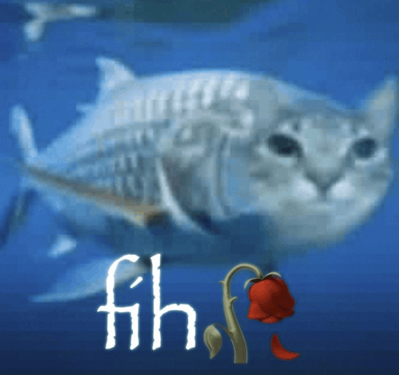

# kNN but it's fish 



Hello who reads this, this is just a test for kNN because we discussed it in class - with fish...

I took the data from this link: [Kaggle – Fish Market](https://www.kaggle.com/datasets/vipullrathod/fish-market)
or this one: [Hugging Face – scikit-learn/Fish](https://huggingface.co/datasets/scikit-learn/Fish).
It's the same data.

## What does it do?

- reads `fish.csv` (7 species, a bunch of measurements per fish)
- uses only **Width** and **Length3** (there's no plain "Length", just Length 1, 2, 3... don't ask)
- splits the fish into 75% training and 25% testing
- trains a kNN classifier (k = 3, for now)
- grabs a random fish out of the test data and guesses what it is
- prints the accuracy and shows a plot where the mystery fish is a big red X

The dataset was in English and idk any of these fish, so I put them into Google Translate. Maybe the German names tell us more (they probably don't):

| English   | Deutsch     |
|-----------|-------------|
| Bream     | Brachse     |
| Parkki    | Güster      |
| Perch     | Flussbarsch |
| Pike      | Hecht       |
| Roach     | Rotauge     |
| Smelt     | Stint       |
| Whitefish | Renke       |

## How to run it

```bash
pip install pandas scikit-learn matplotlib
python main.py
```
